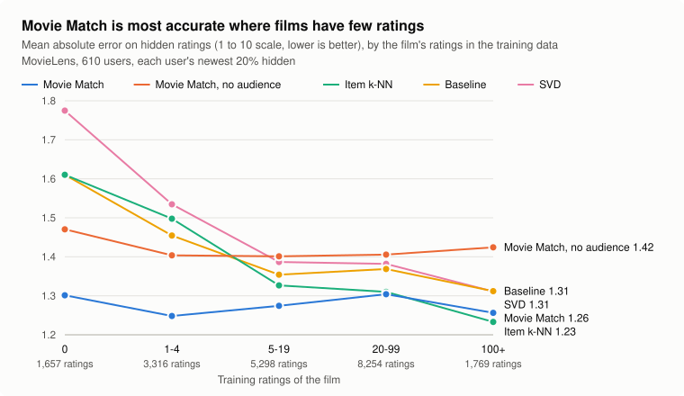

# Benchmark: Movie Match vs standard recommenders

On MovieLens, with each user's newest ratings hidden, Movie Match predicts them with
the lowest error of every method tested: **1.28 points** mean absolute error on the
1–10 scale, against 1.36 for the best collaborative method (item k-NN). It wins most
on films with few or no ratings, the case it was built for (upcoming releases).
Item k-NN is ahead only on the most-rated films.

Without the TMDB audience score, which can leak later votes, Movie Match's advantage
is limited to films with fewer than 5 ratings.



## Setup

- **Data:** MovieLens `ml-latest-small`: 610 users and about 100,800 ratings of the 9,715
  films linked to TMDB, stars doubled onto a 1–10 scale. TMDB has details for 9,602 of the films; the 122 hidden
  ratings of the other 113 are left out for every method.
- **Split by time:** each user's newest 20% of ratings are hidden (at least one, and
  users keep at least 5 older ratings). This asks the realistic question, "predict the
  films they'll watch next", and many of those films have few or no earlier ratings.
  That gives 80,406 training ratings and 20,294 hidden ratings to predict.
- **Who learns from what:** the collaborative methods learn from every user's older
  ratings. Movie Match learns from that user's older ratings only, as in the app,
  plus TMDB metadata (genres, keywords, credits) and, in the full model, the TMDB
  audience score.
- **No tuning:** every method runs with fixed settings; nothing was tuned on these
  hidden ratings.

### Methods

| Method | What it predicts |
| --- | --- |
| Your average | The user's mean training rating (the floor) |
| Baseline | Overall mean + user bias + film bias (Surprise's `BaselineOnly`: ALS, 10 epochs, reg 15 / 10) |
| Item k-NN | Baseline + the user's leftovers on the 40 films rated most alike by the same users (shrunk Pearson-baseline similarity) |
| SVD | Biased matrix factorisation, Surprise's defaults (100 factors, 20 epochs, learning rate 0.005, reg 0.02), trained on stars, seeded |
| Similarity only | Movie Match's content similarity rating (TF-IDF features, 20 nearest rated films) |
| Movie Match, no audience | Similarity + cast and crew track record: never sees a TMDB audience score |
| Movie Match | The full blend the app uses: also the audience score adjusted by the user's learned shift, weighted by vote count |

The collaborative methods are implemented in [`src/benchmark.rs`](src/benchmark.rs).
To check them, Baseline and SVD were also run on MovieLens 100k with Surprise's
5-fold cross-validation and match its
[published results](https://github.com/NicolasHug/Surprise#benchmarks):

| On MovieLens 100k, 5-fold (stars) | This code: MAE / RMSE | Surprise: MAE / RMSE |
| --- | --- | --- |
| Baseline | 0.749 / 0.944 | 0.748 / 0.944 |
| SVD | 0.738 / 0.935 | 0.737 / 0.934 |

## Results

| Method | MAE | RMSE | Mean Spearman | NDCG@10 |
| --- | --- | --- | --- | --- |
| Your average | 1.499 | 1.933 | – | – |
| Baseline | 1.394 | 1.804 | 0.267 | 0.899 |
| Item k-NN | 1.363 | 1.781 | 0.266 | 0.902 |
| SVD | 1.434 | 1.861 | 0.254 | 0.897 |
| Similarity only | 1.422 | 1.869 | 0.160 | 0.890 |
| Movie Match, no audience | 1.411 | 1.853 | 0.176 | 0.892 |
| **Movie Match** | **1.283** | **1.688** | **0.323** | **0.913** |

MAE and RMSE pool every hidden rating. Mean Spearman is each user's rank correlation
between predicted and actual ratings, averaged over users. NDCG@10 asks whether the
films a user rated highest come out on top of their hidden films (1 = perfect).

**MAE by how many training ratings the film has:**

| Method | 0 | 1–4 | 5–19 | 20–99 | 100+ |
| --- | --- | --- | --- | --- | --- |
| Hidden ratings | 1,657 | 3,316 | 5,298 | 8,254 | 1,769 |
| Baseline | 1.610 | 1.455 | 1.354 | 1.369 | 1.312 |
| Item k-NN | 1.610 | 1.498 | 1.327 | 1.310 | **1.233** |
| SVD | 1.775 | 1.535 | 1.387 | 1.382 | 1.311 |
| Movie Match, no audience | 1.471 | 1.404 | 1.401 | 1.405 | 1.424 |
| Movie Match | **1.301** | **1.248** | **1.274** | **1.304** | 1.256 |

## What it shows

- **Collaborative filtering needs ratings.** On films nobody had rated yet, the
  collaborative methods can only fall back to biases (item k-NN and baseline at 1.61,
  SVD at 1.78), and they improve steadily as films gain ratings. Item k-NN is the best
  method of all on films with 100+ ratings.
- **Content works without them.** Movie Match's content-only versions are flat across
  popularity (about 1.40–1.47): they beat every collaborative method on films with fewer
  than 5 ratings and lose to them once films are well rated.
- **The full model wins almost everywhere,** because the audience score adjusted to the
  user carries what the crowd knows, and the blend leans on it as votes grow.
- **SVD trails the baseline here,** unlike on the random split above. With Surprise's
  untuned defaults, the newest films' factors have little data to learn from; a
  time split is harder than random folds.

## Caveats

- **Audience-score leakage.** TMDB's audience score is today's, built from votes that
  include ones cast after the user's rating, so the full Movie Match row is
  optimistic. "Movie Match, no audience" never uses it and is the fair content-only
  comparison. Historical TMDB scores aren't available to fix this properly.
- **Different information.** Movie Match also uses TMDB metadata the collaborative
  methods never see; that is the point of a hybrid, but it isn't a like-for-like
  algorithm comparison.
- **One small dataset, no tuning.** Larger MovieLens sets and tuned collaborative
  methods would likely narrow the gap on well-rated films.

## Reproduce

MovieLens data isn't redistributed: download `ml-latest-small` from
[GroupLens](https://grouplens.org/datasets/movielens/) into `data/movielens/`. With a
`TMDB_API_KEY` in `.env` (or `--server`):

```bash
cargo run --release -- --cache-dir data/movielens-cache --benchmark-movielens data/movielens --movielens-quality --benchmark-csv benchmark.csv
```

The first run fetches TMDB details for about 9,700 films and filmographies for about
20,000 people, cached for later runs (about 2 minutes once cached). Results repeat
exactly: SVD's starting factors are seeded. Without `--movielens-quality`, the
"no audience" row has no track records and equals "similarity only".
